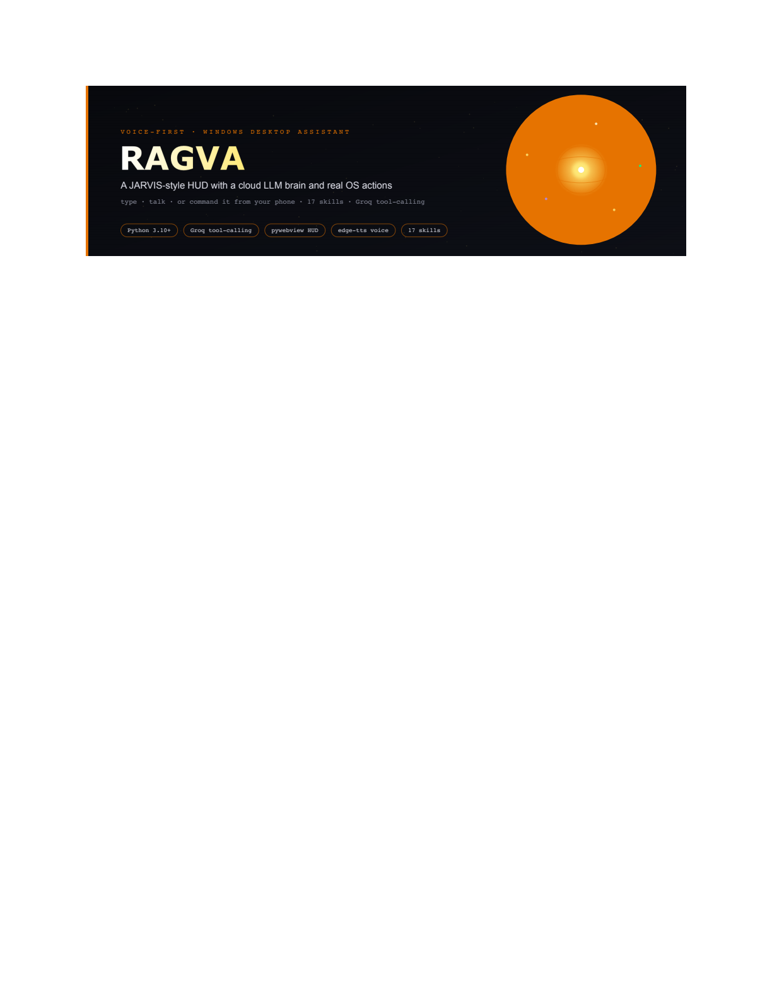

# RAGVA — Banner

**VOICE-FIRST · WINDOWS DESKTOP ASSISTANT**

Type, talk, or send a command from your phone. RAGVA pairs a cloud LLM brain with real OS actions, a pywebview HUD, edge-tts voice, and 17 skills.

Built with Python 3.10+ and Groq tool-calling.

[Download the source PDF](assets/banner.pdf) · [Main README](README.md)
