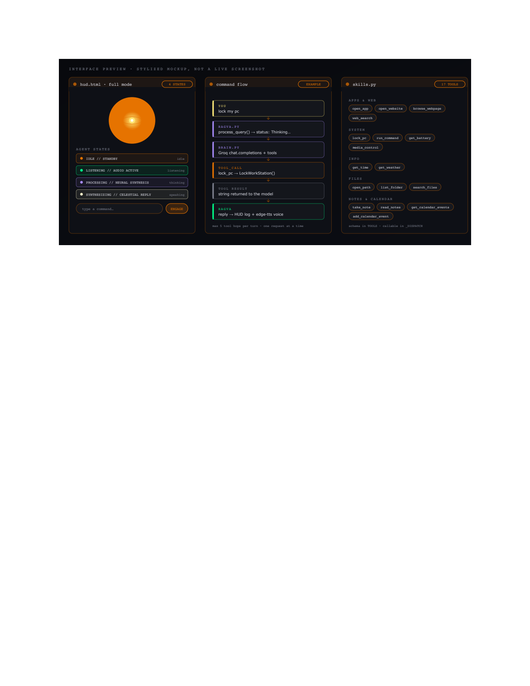

# RAGVA — Preview grid



> Interface preview · stylized mockup, not a live screenshot.

`hud.html` · full mode · **4 states**

| State | Label | Meaning |
|---|---|---|
| Idle | `IDLE // STANDBY` | Waiting for input |
| Listening | `LISTENING // AUDIO ACTIVE` | Microphone capture |
| Processing | `PROCESSING // NEURAL SYNTHESIS` | Model/tool processing |
| Synthesizing | `SYNTHESIZING // CELESTIAL REPLY` | Spoken response |

Input: **“type a command… ENGAGE”**

## Example command flow

```text
YOU          lock my pc
RAGVA.PY     process_query() → status: Thinking…
BRAIN.PY     Groq chat.completions + tools
TOOL_CALL    lock_pc → LockWorkStation()
TOOL RESULT  string returned to the model
RAGVA        reply → HUD log + edge-tts voice
```

**max 5 tool hops per turn · one request at a time**

The grid shows **17 tools** defined in `skills.py` (`TOOLS` schemas and `_DISPATCH`). See the [tool list in the main README](README.md#features).

[Download the source PDF](assets/preview-grid.pdf) · [Main README](README.md)
