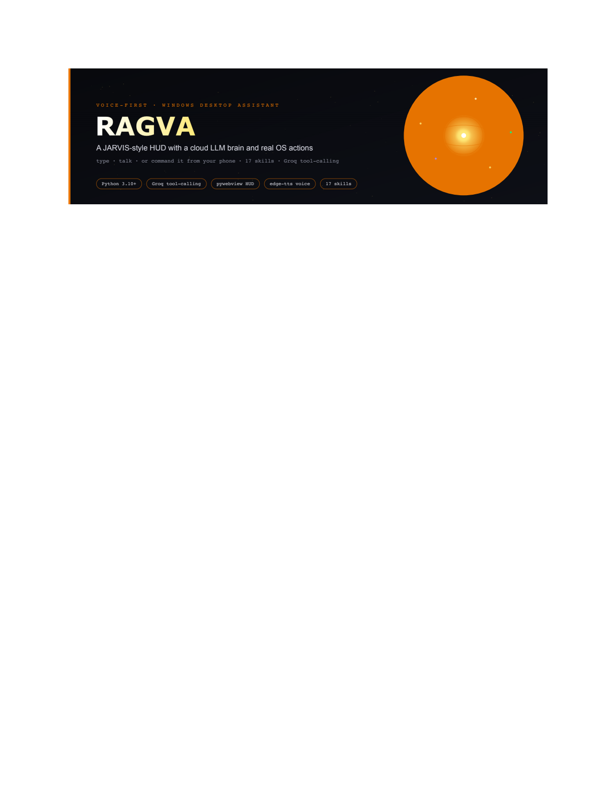
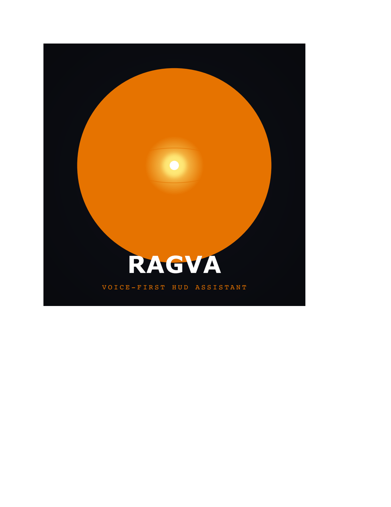
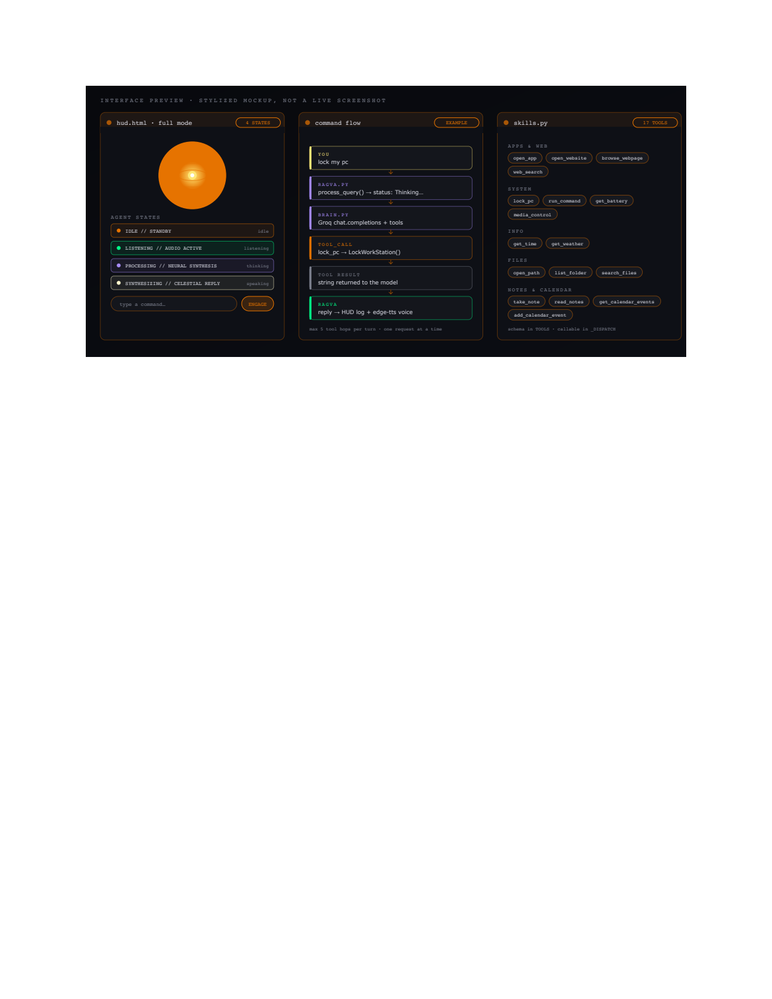

# RAGVA

**A voice-first, Windows desktop assistant.** Type a command, press the mic, or send one from your phone. RAGVA routes the request through Groq tool-calling, runs mapped Python skills, shows the result in a HUD, and speaks it back.

## Concept sheets

> Stylized concept sheets, not live screenshots. Click an image to open its full page.

| Banner | Thumbnail |
|---|---|
| [](README-banner.md) | [](README-thumbnail.md) |

[](README-preview-grid.md)

[Banner](README-banner.md) · [Thumbnail](README-thumbnail.md) · [Preview grid](README-preview-grid.md)

## Features

- **Four-state HUD** — idle, listening, thinking, and speaking, with state-reactive color and a 3D neural core.
- **Real OS actions** — 17 mapped skills covering apps, files, notes, calendar, weather, media, and Windows controls.
- **Voice and text** — push-to-talk microphone input, typed input, and Edge TTS spoken replies.
- **Optional phone control** — a disabled-by-default LAN endpoint for sending commands from another device.
- **Bounded tool loop** — up to five tool hops per request, one request at a time.

| Category | Tools |
|---|---|
| Apps & web | `open_app`, `open_website`, `browse_webpage`, `web_search` |
| System | `lock_pc`, `run_command`, `get_battery`, `media_control` |
| Info | `get_time`, `get_weather` |
| Files | `open_path`, `list_folder`, `search_files` |
| Notes & calendar | `take_note`, `read_notes`, `get_calendar_events`, `add_calendar_event` |

## Requirements

- Windows 10/11, Python 3.10+, Microsoft Edge WebView2 Runtime
- A Groq API key
- Microphone and speakers for voice features

## Quick start

```powershell
git clone https://github.com/mohdnajiii17-tech/ragva.git
cd ragva
py -m venv .venv
.\.venv\Scripts\Activate.ps1
pip install -r requirements.txt
$env:GROQ_API_KEY = "your-groq-key"
python ragva.py
```

Optional wake-phrase launcher (runs in the background and starts the app on command):

```powershell
python launcher.py
```

## Configuration

Settings live in [`config.py`](config.py). Secrets are read from environment variables; no key is stored in source control.

| Variable | Default | Purpose |
|---|---|---|
| `GROQ_API_KEY` | *(required)* | Groq credentials |
| `GROQ_MODEL` | `openai/gpt-oss-20b` | Reasoning model |
| `RAGVA_ENABLE_PHONE_SERVER` | `0` | Enable the phone control endpoint |
| `RAGVA_PHONE_HOST` | `127.0.0.1` | Phone endpoint bind address |
| `RAGVA_PHONE_PORT` | `5005` | Phone endpoint port |

Voice, wake-word, history, and threshold settings are documented inline in `config.py`.

## Project structure

```text
ragva/
├── README.md             # main overview
├── README-banner.md      # banner concept sheet
├── README-thumbnail.md   # thumbnail concept sheet
├── README-preview-grid.md  # preview-grid concept sheet
├── ragva.py          # entry point and request routing
├── brain.py          # Groq tool-calling loop and conversation history
├── skills.py         # tool schemas and implementations
├── audio_io.py       # speech recognition and text-to-speech
├── gui_web.py        # pywebview window and JS bridge
├── hud.html          # HUD markup, styling, and 3D scene
├── phone_server.py   # optional phone control endpoint
├── launcher.py       # optional wake-phrase listener
├── config.py         # settings and environment-based secrets
├── requirements.txt
├── assets/           # concept-sheet PDFs and rendered PNG previews
│   └── previews/     # images embedded in the README
└── docs/             # architecture and security notes
```

## Security

This is a prototype, not a hardened product. Read [`docs/ARCHITECTURE.md`](docs/ARCHITECTURE.md) before running it. In particular, `run_command` executes shell commands with your privileges, voice and reply text are sent to third-party services, and the phone endpoint must stay disabled or be explicitly secured before it is exposed on a network.

## Documentation

- [Architecture, limitations, and security notes](docs/ARCHITECTURE.md)
- [Banner](README-banner.md) · [Thumbnail](README-thumbnail.md) · [Preview grid](README-preview-grid.md)
