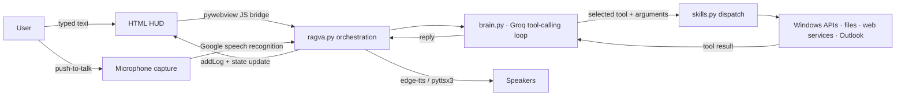
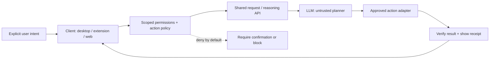

# RAGVA — Architecture and Security Notes

**A voice-and-text desktop assistant for everyday computer tasks.** RAGVA connects a small HUD to a cloud language model, a set of Python skills, and speech input/output. Ask in plain language; RAGVA can call a mapped tool, show the response, and speak it back.

> **Prototype status:** This document began as an architecture review of a `CONTEXT.md` snapshot (2026-11-24) and has been updated to match the source in this repository. The prototype is a **Windows desktop app**; a browser extension and a standalone web client are **future product directions**, not implemented features.

---

## Track framing: Beyond the Browser

The supplied CodeRIT event page describes a challenge around the friction of navigating sites, finding relevant information, comparing options, and finishing online tasks—and calls for browser-based agents that make the web smoother and more accessible. RAGVA is presented in that track as an early direction toward reducing multi-step task friction. **The supplied implementation is not a browser agent:** it is a Windows desktop assistant. Browser-page actions, a browser extension, and a web client are future work and must not be presented as implemented.

## At a glance

| | Current prototype |
|---|---|
| Platform | Windows desktop; pywebview with Microsoft WebView2 |
| Interface | Single-file HTML HUD, Three.js visualization, text box and push-to-talk control |
| Reasoning | Groq chat-completions API; configured model `openai/gpt-oss-20b` |
| Actions | 17 tool schemas and Python dispatch entries, including Windows controls, files, web requests and Outlook integration |
| Voice | Google Web Speech recognition through SpeechRecognition; Edge TTS spoken output by default |
| Persistence | Conversation history in process memory; notes appended to `notes.txt` |
| Offline mode | None: reasoning and several voice/UI dependencies require internet |
| Browser extension / web app | Not present in the supplied prototype; roadmap only |

This is an early personal-assistant prototype, **not a hardened security product**. Review the security and privacy notes before running it.

## How a request moves through RAGVA



The phone-control path is separate: `phone_server.py` accepts a LAN HTTP request and calls the same `brain.ask()` entry point. See [Network exposure](#network-exposure-phone-server) before enabling or exposing that endpoint.

### Main modules

| Module | Responsibility |
|---|---|
| `ragva.py` | Entry point, input routing, state changes, reset/exit handling, worker threads |
| `brain.py` | Serial Groq request loop, tool-call execution and in-memory conversation history |
| `skills.py` | Tool JSON schemas, Python implementations and name-to-function dispatch |
| `audio_io.py` | Microphone capture/transcription and text-to-speech |
| `gui_web.py` | pywebview window, JavaScript bridge and Python-to-HUD updates |
| `hud.html` | HUD markup, CSS, Three.js scene, state styling, input and log UI |
| `config.py` | Model, voice, flags and other settings; secrets are read from environment variables |
| `phone_server.py` | Optional Flask LAN endpoint for phone-originated commands |
| `launcher.py` | Optional background launch-phrase listener |

## What the prototype can do

The prototype context documents **17** tools, each requiring a schema in `TOOLS` and a corresponding function in `_DISPATCH` in `skills.py`:

| Tool | Capability |
|---|---|
| `open_app` | Launch a mapped Windows app |
| `open_website` | Open a URL in the default browser |
| `get_time` | Return the local date and time |
| `get_weather` | Retrieve current weather via Open-Meteo geocoding and forecast APIs |
| `lock_pc` | Lock the Windows workstation |
| `take_note`, `read_notes` | Append to and read the local `notes.txt` file |
| `get_battery` | Report battery status where supported |
| `run_command` | Run a shell command with a 30-second timeout (high risk; see below) |
| `web_search` | Search using `ddgs` (documented dependency is missing in the supplied environment) |
| `browse_webpage` | Fetch a web page and extract text |
| `get_calendar_events`, `add_calendar_event` | Read/create Outlook appointments through COM |
| `media_control` | Send Windows media-key events |
| `open_path`, `list_folder`, `search_files` | Open, list, and recursively search local paths |

Availability depends on the Windows environment, installed packages, network access, configured credentials and the relevant applications. The list describes tool wiring, not a guarantee that each integration succeeds on every machine.

## HUD and interaction

The visual direction is a dark, high-contrast HUD: near-black `#020306`, solar amber accents, Sora interface typography, JetBrains Mono for data, state-reactive color, scanline treatment, a five-bar equalizer and a 3D “solar neural core.” The shipped HUD includes full, dock, widget and orb modes.

| State | Prototype accent | Meaning |
|---|---|---|
| Idle | Amber `#e67300` | Waiting |
| Listening | Green `#00ff88` | Microphone capture |
| Thinking | Violet `#a78bfa` | Model/tool processing |
| Speaking | Pale gold `#fff8cc` | Spoken response |

Inputs: type and press Enter, click the microphone, or use Space for push-to-talk when the text field is not focused. Esc closes a modal or restores the full view from orb mode. The `LOGS` control opens the conversation log.

### Design principles for future clients

The browser-extension and web-app directions should carry the same state palette and calm HUD language, while adapting controls to each platform. They are planned surfaces—not features in the delivered prototype. Browser page access should be opt-in, visibly scoped to the active tab, and independently permissioned; it must not silently inherit unrestricted desktop privileges.

## Setup and running (Windows)

The supplied snapshot was tested on Windows with Python 3.14.7. It reports Python 3.10+ in its setup notes; GUI, audio and native dependencies may behave differently across Python and Windows versions. WebView2 Runtime and a working microphone/speaker are needed for the corresponding features.

1. Clone this repository to your Windows machine.
2. Create and activate a virtual environment.
3. Install the dependencies: `pip install -r requirements.txt`. Install only the optional integrations you intend to use.
4. Install Microsoft Edge WebView2 Runtime if it is not already present.
5. Set a valid Groq API key in the environment, for example `$env:GROQ_API_KEY = "your-key"` in PowerShell. `config.py` reads it from the environment; **never commit a key to source control**. Revoke/rotate any key that was previously exposed.
6. From the source directory, start the application:

   ```powershell
   python ragva.py
   ```

Optional: `python launcher.py` starts the separate wake-phrase listener. Its launch phrase is configured separately from the in-app wake word.

### Configuration notes

Configuration is described in `config.py`. Important settings include `GROQ_MODEL`, `ASSISTANT_NAME`, `TTS_ENGINE`, Edge TTS voice/rate/pitch, speech thresholds, `CONTINUOUS_LISTEN`, `REQUIRE_WAKE_WORD`, history length, and the phone-server host/port. Current defaults and caveats:

- Model: `openai/gpt-oss-20b`; all reasoning is sent to Groq.
- TTS: `edge-tts` with voice `en-GB-RyanNeural`; `pyttsx3` is an alternate local synthesis engine.
- Transcription: Google Web Speech; the configured Whisper model size is unused in the described implementation.
- Continuous listening is off by default; push-to-talk and typed input are the default interaction modes.
- `WAKE_WORD` (in-app loop) and `LAUNCH_PHRASE` (separate launcher) are distinct settings.
- The phone server is disabled by default. Enable it with `RAGVA_ENABLE_PHONE_SERVER=1` only after adding authentication and network controls; it binds to `127.0.0.1` by default.

## Integrations and data handling

| Integration | Use | Network / local boundary |
|---|---|---|
| Groq API | Reasoning and tool selection | User request, conversation context, tool results and possibly file/web-derived text leave the device |
| Google Web Speech | Voice transcription | Captured audio is sent to Google's speech service |
| Edge TTS | Default spoken replies | Reply text is sent to Microsoft's service |
| Open-Meteo | Weather lookup | Location query sent over the network; no key documented |
| DuckDuckGo search (`ddgs`) | Web search | Search query sent to the search service; requires `ddgs` to be installed |
| Arbitrary HTTP (`requests`) | Web page fetch | Requested page contacted; returned text enters the model's tool context |
| Outlook COM | Calendar access | Runs locally through installed Outlook; appointments are read or created |
| Windows APIs / filesystem | Launch, lock, media, files, notes | Acts with the current user's Windows permissions |
| HUD CDNs | Tailwind, Three.js and Google Fonts | Assets load from external CDNs; styling/3D may fail offline |

Conversation history is kept in memory and trimmed by message count in the supplied code description. `notes.txt` persists locally. The prototype does not provide a complete privacy dashboard, secure audit log, or a documented encrypted store. Treat model replies and retrieved page content as untrusted.

## Security: read before use

The architecture review identifies important risks in this prototype:

1. **Credential handling:** `config.py` reads `GROQ_API_KEY` from the environment and contains no secret. Revoke/rotate any key that was previously exposed, and keep secrets out of source control.
2. **Arbitrary command execution:** `run_command` uses `subprocess.run(..., shell=True)` on model-supplied text. This can execute commands with the user's privileges. Disable it until replaced with a strict allowlist and explicit user confirmation.
3. **Unauthenticated LAN endpoint:** the optional Flask endpoint has no authentication, TLS or rate limiting. It is disabled by default and binds to `127.0.0.1`; do not expose it to a LAN until authentication and network controls are added.
4. **Prompt injection:** fetched web content can influence the model's tool context. A prompt instruction is not a security boundary. Keep untrusted content away from privileged actions and require confirmation.
5. **Broad local access:** file tools and Outlook COM run in the user's security context. Constrain accessible paths and actions.
6. **Unsafe HUD rendering:** the snapshot reports model text inserted through `innerHTML` without escaping. Render untrusted content as text (`textContent`) and sanitize any intentional markup.
7. **Privacy disclosure:** prompts and transcripts go to cloud services; speech is sent to Google; default speech synthesis uses Microsoft's service. Disclose this and provide an explicit user choice before recording or transmission.

**Do not expose RAGVA to a network or use it with sensitive data until these issues have been addressed and tested.** This document is not a security audit or a certification.

## Limitations documented in the supplied snapshot

- Windows-only native actions and pywebview shell; no browser extension or web client yet.
- No local language model or offline reasoning path.
- `web_search` fails if the `ddgs` dependency is not installed.
- No automated dependency-pinning or vulnerability scan is configured.
- `listen_once(timeout=...)` accepts but does not honor its `timeout` argument; phrase length is governed by the phrase cap.
- A history trim can split an assistant tool-call record from its tool results.
- HUD settings controls are described as decorative/unwired; one voice-simulation hint points to an undefined function.
- Web assets are CDN-dependent; early UI updates can be lost while the page is loading.
- Phone, voice, and GUI requests use threads; the reasoning lock serializes Groq turns and there is no request cancellation.
- No automated tests, CI, packaging metadata or structured persistent logs were present in the described folder snapshot.

## Roadmap: product direction, not current implementation

A plausible staged path for extending RAGVA to desktop, browser and web is:

1. **Harden the desktop core:** remove embedded secrets; disable or gate shell execution; secure/disable the phone API; add action-level approvals, logging and tests.
2. **Define a least-privilege action API:** keep privileged native skills behind a local, authenticated boundary. Give each client only the capabilities the user explicitly grants.
3. **Build a browser extension:** optional, per-site permissions; explicit active-tab scope; DOM-first, user-visible actions; confirmation for consequential changes; clear distinction between page text and trusted instructions.
4. **Build a web client:** responsive conversation UI to a secured API, with authentication, user-owned settings and server-side secret handling. A web page must not assume it can perform desktop OS actions.
5. **Add cross-platform native adapters:** use platform accessibility APIs and per-OS permission prompts; do not treat Windows-specific skills as portable.
6. **Measure before broad claims:** evaluate task completion, time, retries, user trust, accessibility and failure recovery with consenting pilot users. Publish measured results only after testing.



## Development notes

To add a tool in the described architecture:

1. Add a JSON schema to `TOOLS` in `skills.py`.
2. Implement a function that validates arguments and returns a concise result.
3. Register the function in `_DISPATCH`.
4. Add tests for schema/dispatch parity, invalid input, error handling, permission boundaries and confirmation behavior.

Prefer argument arrays over shell strings, path allowlists over broad filesystem access, turn-boundary history trimming, structured logs with redaction, and `textContent` for untrusted HUD output. Keep network services disabled by default unless they are required and secured.

## License and project metadata

The supplied context did not specify a license, repository URL, maintainers, or an official track/team identifier. Add those from authoritative project sources before publishing; none are inferred here.
